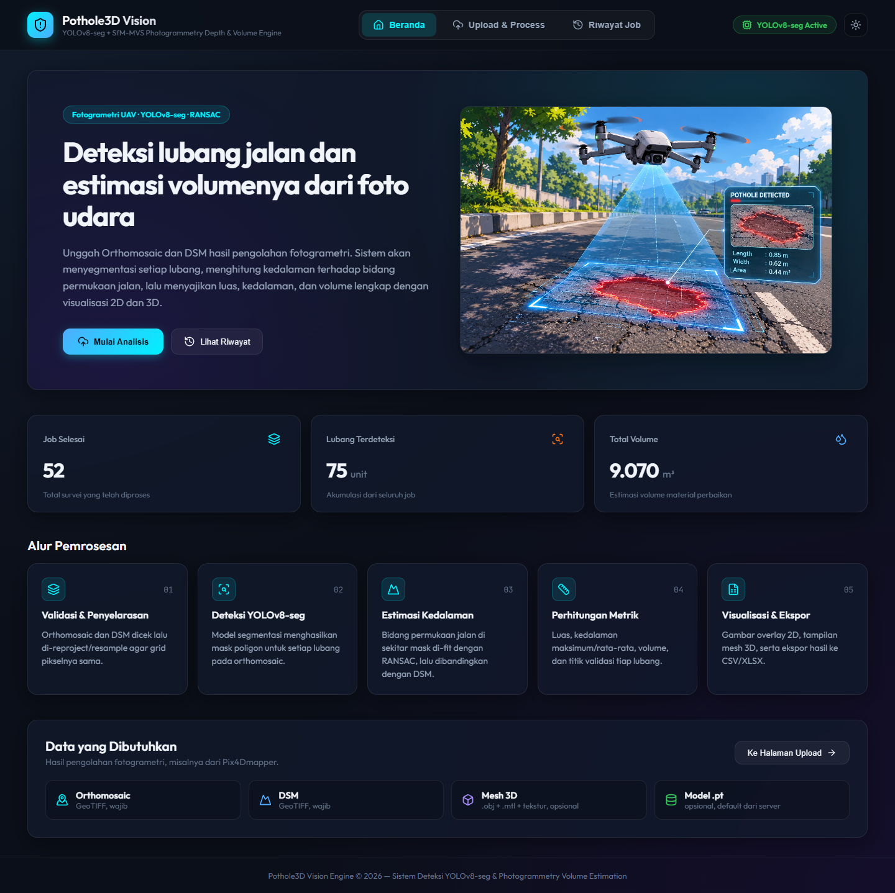
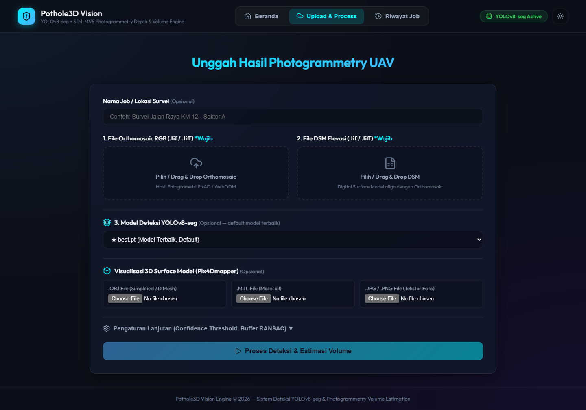
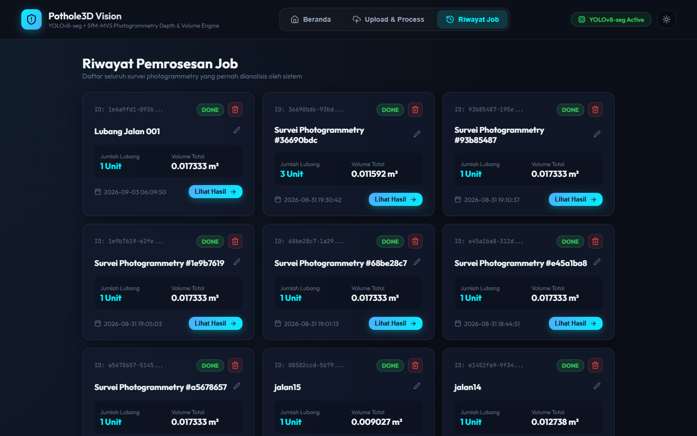
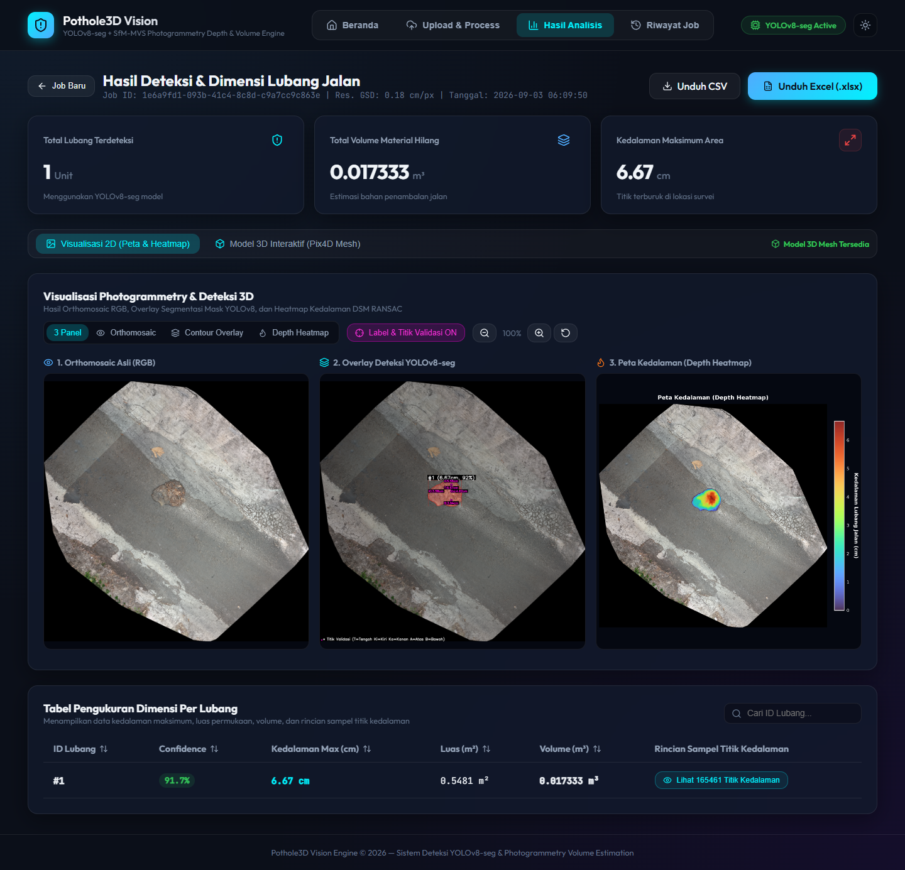
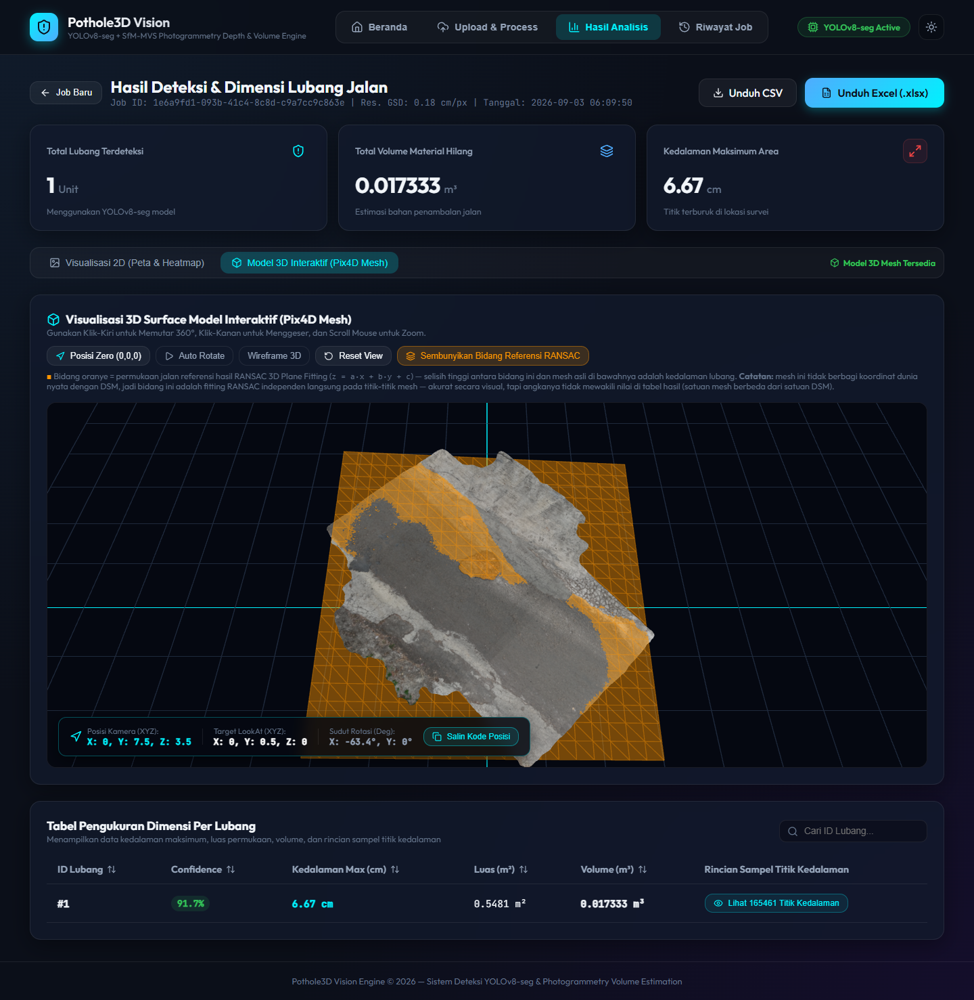
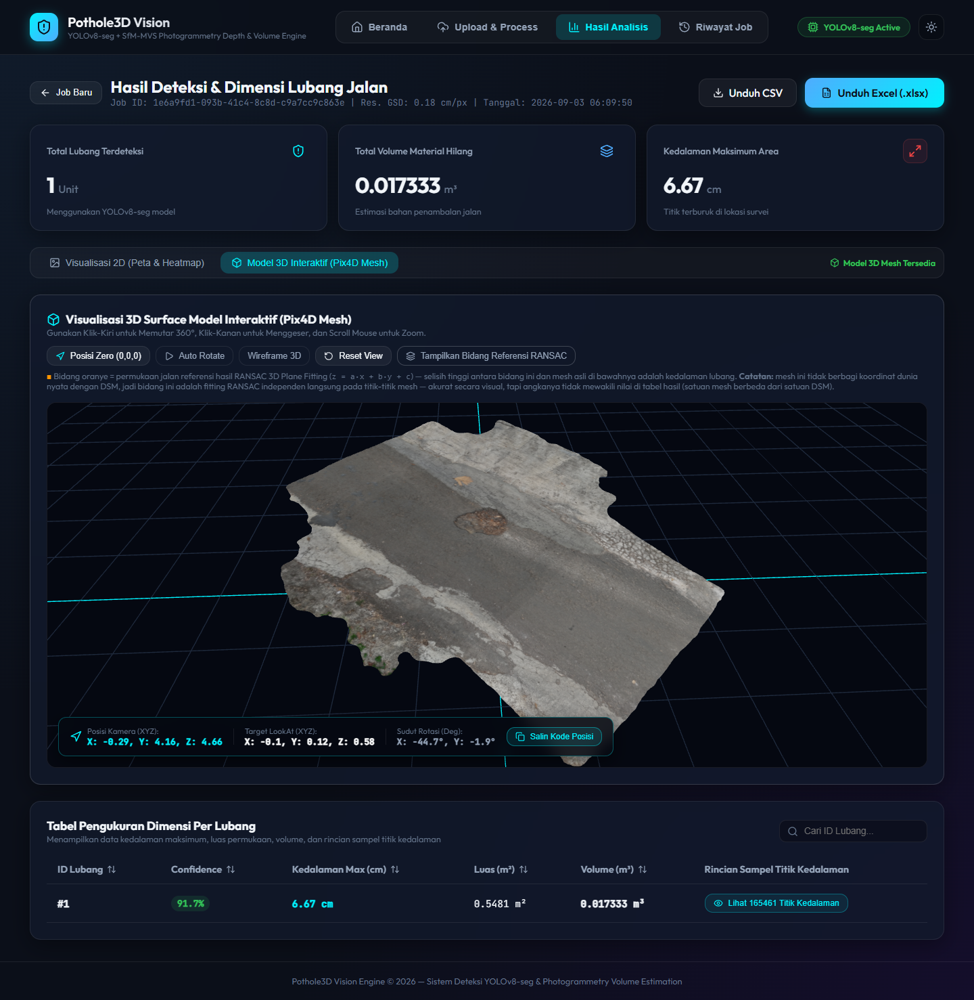
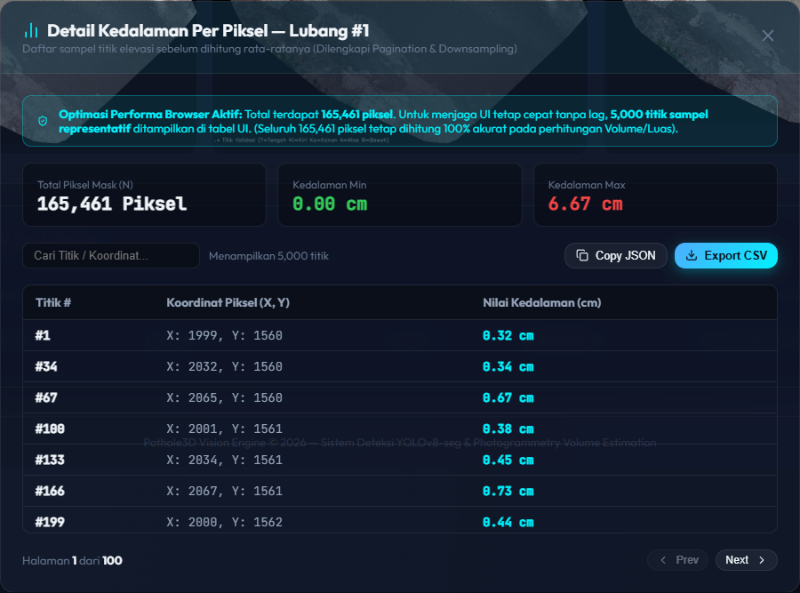

# Dokumentasi Tampilan Sistem – Pothole3D Vision

Kumpulan tangkapan layar aplikasi web **Pothole3D Vision** dalam tema gelap, diambil pada resolusi layar 1440 px. Contoh hasil analisis memakai job **"Lubang Jalan 001"**.

Cara menjalankan aplikasi dijelaskan di [README utama](../README.md).

## Daftar Isi

1. [Beranda](#1-beranda)
2. [Upload & Process](#2-upload--process)
3. [Riwayat Job](#3-riwayat-job)
4. [Hasil Analisis – Visualisasi 2D](#4-hasil-analisis--visualisasi-2d)
5. [Hasil Analisis – Model 3D](#5-hasil-analisis--model-3d)
6. [Hasil Analisis – Model 3D tanpa Bidang RANSAC](#6-hasil-analisis--model-3d-tanpa-bidang-ransac)
7. [Detail Titik Kedalaman](#7-detail-titik-kedalaman)

---

## 1. Beranda



Halaman pertama saat aplikasi dibuka. Isinya:

- **Pengantar sistem** dengan tombol **Mulai Analisis** (ke halaman Upload) dan **Lihat Riwayat**.
- **Ringkasan**: jumlah job selesai, total lubang terdeteksi, dan total volume dari seluruh riwayat.
- **Alur pemrosesan** dalam lima tahap: validasi dan penyelarasan, deteksi YOLOv8-seg, estimasi kedalaman (RANSAC), perhitungan metrik, serta visualisasi dan ekspor.
- **Data yang dibutuhkan**: Orthomosaic, DSM, Mesh 3D, dan Model `.pt`.

## 2. Upload & Process



Formulir untuk membuat job analisis baru:

| Isian | Keterangan |
|---|---|
| Nama Job / Lokasi Survei | Opsional, untuk menamai job di riwayat |
| File Orthomosaic RGB (`.tif`/`.tiff`) | **Wajib** |
| File DSM Elevasi (`.tif`/`.tiff`) | **Wajib**, harus selaras dengan Orthomosaic |
| Model Deteksi YOLOv8-seg | Opsional, default `best.pt` |
| Visualisasi 3D (`.obj`, `.mtl`, tekstur) | Opsional, untuk tampilan mesh 3D |
| Pengaturan Lanjutan | *Confidence threshold* (default 0,60) dan *buffer* RANSAC (default 15 px) |

Tombol **Proses Deteksi & Estimasi Volume** mengirim data ke backend, lalu halaman berpindah ke tampilan progres.

## 3. Riwayat Job



Daftar semua job yang pernah diproses. Setiap kartu menampilkan status, nama job, jumlah lubang, total volume, dan tanggal proses. Pengguna dapat:

- mengganti nama job (ikon pensil),
- menghapus job (ikon tempat sampah),
- membuka hasil lewat tombol **Lihat Hasil**.

## 4. Hasil Analisis – Visualisasi 2D



Hasil analisis job "Lubang Jalan 001":

- **Kartu metrik**: 1 lubang terdeteksi, total volume 0,017333 m³, dan kedalaman maksimum 6,67 cm.
- **Tiga panel visualisasi**:
  1. Orthomosaic asli (RGB),
  2. Overlay mask segmentasi YOLOv8-seg beserta label dan titik validasi,
  3. Peta kedalaman (*depth heatmap*) hasil selisih bidang RANSAC dengan DSM.
- **Tabel pengukuran per lubang**: confidence 91,7%, kedalaman maksimum 6,67 cm, luas 0,5481 m², dan volume 0,017333 m³.
- Tombol **Unduh CSV** dan **Unduh Excel (.xlsx)** untuk mengekspor hasil.

## 5. Hasil Analisis – Model 3D



Tampilan mesh 3D interaktif dari Pix4Dmapper. Bidang oranye adalah permukaan jalan referensi hasil *RANSAC 3D plane fitting*. Mesh dapat diputar (klik kiri), digeser (klik kanan), dan diperbesar (scroll). Tersedia juga mode *auto rotate*, *wireframe*, dan *reset view*.

## 6. Hasil Analisis – Model 3D tanpa Bidang RANSAC



Mesh 3D yang sama setelah tombol **Sembunyikan Bidang Referensi RANSAC** ditekan. Tanpa bidang oranye, permukaan jalan dan cekungan lubang terlihat jelas. Sudut pandang kamera diatur ke:

```js
camera.position.set(-0.29, 4.16, 4.66);
controls.target.set(-0.1, 0.12, 0.58);
```

Posisi ini terlihat di panel koordinat kiri bawah viewer dan dapat disalin dengan tombol **Salin Kode Posisi**.

## 7. Detail Titik Kedalaman



Muncul saat menekan **Lihat … Titik Kedalaman** pada tabel hasil. Jendela ini menampilkan nilai kedalaman per piksel di dalam mask lubang. Isinya: jumlah piksel mask, kedalaman minimum dan maksimum, serta tabel koordinat piksel dengan kedalamannya. Data dapat disalin sebagai JSON atau diekspor ke CSV.

Untuk menjaga browser tetap ringan, tabel hanya menampilkan 5.000 titik sampel. Perhitungan volume dan luas tetap memakai seluruh piksel.
